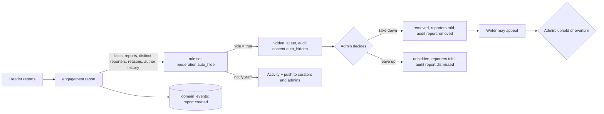
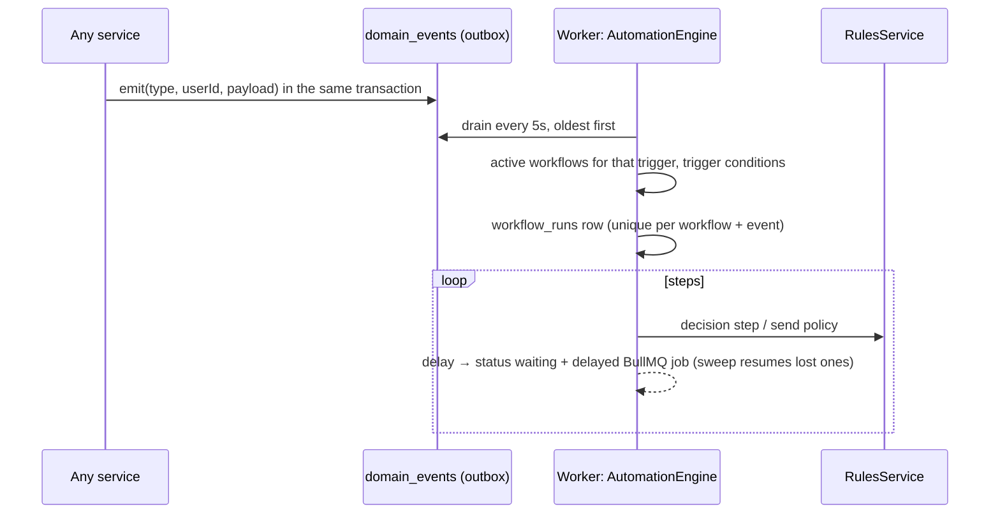

# v1 additions: landing page, moderation, admin console, rules and automations

What was added for v1, how it fits the existing modular monolith, and what is still open.
Status: built, not yet tested end to end (see "Before merging").

| Item | What shipped |
| --- | --- |
| Landing page | `/` for signed-out visitors: hero with a sealed joke you can open, numbers, how it works, why it exists, readers vs writers, shop teaser, FAQ, final call to action. Data from `GET /v1/public/landing`. |
| Shop | `/shop` is a **coming soon** placeholder (previews, no checkout). No shop tables or payments yet. |
| Reporting | Reason picker and note, auto-hide by rule set, reporters told the outcome, curator hide/unhide for comments, admin decisions with an audit trail, writer appeals. |
| Admin console | `/admin`: overview, money (from the ledger, CSV export), engagement and streaks, people (mini CRM with tags, roles, suspension), moderation, workflows, runs, rule sets, audit log. |
| Rules and workflows | `rules` module (rule sets, versions, tests to publish, evaluate with trace) and `automation` module (event outbox, workflows, durable waits, send policy). Admin builder screens modelled on the expresso decisions UI. |

## Running it

```bash
pnpm db:migrate      # applies 0007_v1_moderation_automation and creates the system rule sets
pnpm db:seed         # also creates admin@daddyjokes.local (role admin)
pnpm dev             # the worker now also runs automations
```

Make anyone an admin with `pnpm --filter api user:role <email> admin`.
`packages/contracts` (`openapi.json`, `schema.d.ts`) is already regenerated; run `pnpm contracts` after further API changes.

## Who can do what

| Action | Reader / writer | Curator | Admin |
| --- | :---: | :---: | :---: |
| Report a joke or comment | ✓ | ✓ | ✓ |
| See reports and appeals (`/curate`) | | ✓ | ✓ |
| Hide / unhide a comment | | ✓ | ✓ |
| Take a joke or comment down, or dismiss reports | | | ✓ |
| Delete someone else's comment | | | ✓ |
| Decide appeals | | | ✓ |
| Admin console, money, people, workflows, rule sets, audit | | | ✓ |
| Appeal a takedown of my own joke | writer | | |

Curating (review queue, scheduling, declining) is unchanged and stays with curators.
Suspended accounts get `403 account_suspended` on every request, and their sessions are revoked.

## Moderation flow



- Hidden jokes stop being delivered, return 404 to readers (423 `joke_under_review` when opening the day's joke) and stay visible to the writer and staff. Hidden comments are visible only to their author and staff.
- If `moderation.auto_hide` is missing or archived, the code falls back to "three different reporters".
- `POST /v1/reports` now returns `200 { alreadyReported, hidden }` instead of `204`.

## Rules (`apps/api/src/rules`)

Copied from expresso's design: **we own the model, rules are data, decisions come with a trace.**

- **Model** (`model.ts`): conditions (`field`, `op`, `value` or `{ ref }`) in nested `all` / `any` / `none` groups; outcomes are `key = value` outputs (text may use `{{fact.path}}`); hit policy `first` or `collect`; test cases inside the definition.
- **Evaluator** (`engine.ts`): pure TypeScript, no I/O and no code execution. Expresso compiles to CEL; here a small interpreter is enough for v1 because nothing evaluates free-form expressions. The JSON model is ours, so adding CEL later (for an `fx` escape hatch) means writing a compiler, not migrating data.
- **Lifecycle:** edit the draft (optimistic `revision`) → *Test and publish* runs every test and refuses on any failure → an immutable `rule_set_versions` row → live. Restore any version into the draft. Live versions are cached per process for 15 seconds.
- **Decision points** (`catalog.ts`) list the facts each caller provides, so the builder only offers real fields: `moderation.report`, `automation.send_policy`, and `workflow` (person `user.*` + event `event.*`).
- **System rule sets** (`system.ts`) are created by migrations in every environment and can be edited but not archived: `moderation.auto_hide` and `automation.send_policy` (quiet hours 9pm–7am local time, at most 2 automated messages a day, the same workflow at most 3 a week).

## Automations (`apps/api/src/automation`)



- **Triggers** (`platform/event-types.ts`): `user.signed_up`, `delivery.opened`, `delivery.unopened` (10h after delivery, still sealed), `delivery.missed`, `streak.milestone` (3, 7, 14, 30, 50, 100…), `subscription.created`, `tip.paid`, `report.created`, `manual`. Unopened and missed come from a 10-minute delivery scan.
- **Steps:** filter, decision (rule set), delay, wait until a local hour, push, email, Activity item, add or remove tag, alert curators. Messages always pass `automation.send_policy` first; blocked ones are logged as *skipped* with the reason.
- **Versions:** publishing freezes the graph, and runs execute the version they started on. Test runs (`Test` button) use the draft for one person and skip waits.
- **Templates:** streak at risk, welcome series, win back lapsing readers, welcome back, celebrate streaks, alert curators about hidden content. They're created as drafts; nothing is on until someone publishes it.
- **Mini CRM:** `user_tags` (from admins or workflows) plus person facts (`user.streak`, `user.missedLast7d`, `user.subscriptions`, …), searchable in People and usable in any condition.

Not in v1 (kept narrow on purpose): branches with separate paths (use Filter and Decision steps), approval or human-task steps, a free-form expression (`fx`) editor, lookup lists, drag-to-reorder on the canvas.

## New tables (migration `0007_v1_moderation_automation`)

`audit_log`, `appeals`, `rule_sets`, `rule_set_versions`, `workflows`, `workflow_versions`, `workflow_runs`, `workflow_run_steps`, `domain_events`, `user_tags`, `automation_messages`; new columns `users.suspended_at` / `suspended_reason`, `jokes.hidden_at`, `comments.hidden_at`; new notification types `report_resolved`, `appeal_resolved`, `automation`.

## New endpoints

| Area | Endpoints |
| --- | --- |
| Public | `GET /v1/public/landing` |
| Moderation | `POST /v1/curation/comments/{id}/hide` · `/unhide` (curators); `GET /v1/curation/reports?status=open\|resolved`; `POST /v1/curation/reports/resolve` (now admins only, optional `note`); `POST /v1/me/jokes/{id}/appeal`, `GET /v1/me/appeals`; `GET /v1/curation/appeals`, `POST /v1/curation/appeals/{id}/resolve` (admins) |
| Admin | `GET /v1/admin/overview`, `/finance?days=`, `/finance/ledger.csv`, `/engagement?days=`, `/users`, `/users/{id}`, `PUT /users/{id}/roles`, `POST /users/{id}/suspend` · `/unsuspend`, `PUT·DELETE /users/{id}/tags/{tag}`, `GET /tags`, `GET /audit` |
| Rules | `GET /v1/admin/decision-points`; `GET·POST /v1/admin/rules`; `GET /rules/{id}`; `PUT /rules/{id}/draft`; `POST /rules/{id}/evaluate` · `/test` · `/publish` · `/archive` · `/unarchive`; `GET /rules/{id}/versions[/{v}]`; `POST /rules/{id}/versions/{v}/restore` |
| Automations | `GET /v1/admin/automation/catalog` · `/stats`; `GET·POST /v1/admin/workflows`; `GET·DELETE /workflows/{id}`; `PUT /workflows/{id}/draft`; `POST /workflows/{id}/publish` · `/pause` · `/activate` · `/discard-draft`; `GET /workflows/{id}/versions`, `POST …/versions/{v}/restore`; `GET·POST /workflows/{id}/runs`; `GET /v1/admin/runs[/{runId}]` |

## Before merging

Nothing here has been run against a database yet. Things to check by hand, and tests to add:

- Existing e2e tests that now need updating: `engagement.e2e.test.ts` expects `204` from `POST /v1/reports` (now `200` with a receipt), lets a **curator** resolve reports and delete another person's comment (both now admin only), and checks the comment shape (now also `canHide`, `hidden`).
- New e2e coverage worth adding: auto-hide after two offensive reports; hidden joke not delivered; admin take-down notifies reporters; appeal overturn restores the joke; rule publish blocked by a failing test; a workflow run from `delivery.unopened` with the send policy skipping at quiet hours; a delay resuming after the sweep.
- The landing page is client-rendered. For search engines, prerender `/` and `/shop` at build time (e.g. a small Vite prerender step) or serve a static HTML version from Caddy.

## Open questions

1. **Shop fulfilment and launch:** local print partner, print-on-demand abroad, or own stock? The shop stays a placeholder until this is decided; the earlier design (products, variants, orders, M-Pesa STK checkout, ledger postings) is ready to build.
2. **Writer royalties on merch:** do writers get a share of merch featuring their joke, and how much? It affects the writer pledge (consent and opting out per joke) and the ledger accounts (`platform:merch`, `creator:<id>`).
3. **Automation email unsubscribe:** emails include a footer, but there's no per-person "no marketing email" preference yet. Add one before turning on email-heavy workflows in production.
4. **Who may edit system rule sets:** today any admin can. Consider a separate "platform admin" role if more people get admin.
